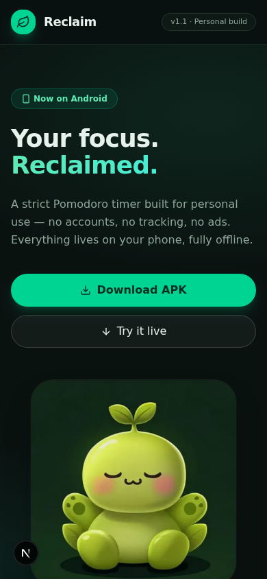

<<<<<<< HEAD
# ReCalm

A personal, offline-first Android focus timer with **real app blocking** — a
Regain/Refocus-style study companion shipped as a single signed APK.

Strict Pomodoro sessions, a foreground shield that locks Instagram, YouTube &
friends while you focus, Reels-only blocking that still lets you use Instagram,
weekly schedules, per-day time limits, urge surfing, streaks — and **zero
network use**: the app does not even hold the `INTERNET` permission.

Launcher name **ReCalm** · package id `com.personal.reclaim` · Android 7.0+
(API 24+)

<p align="center">
  
</p>

---

## What it does

**Focus timer**
- Strict Pomodoro / focus timer — sessions are timestamp-based, so they survive
  app restarts and background freezes; day boundaries use IST (UTC+5:30)
- Strict mode — pausing is disabled; giving up needs a deliberate 3-second
  long-press, your PIN (if set) **and a solved 16-piece jigsaw**, and is
  recorded honestly as an abandoned session

**Real app blocking**
- Pick any installed app (Instagram, Facebook, YouTube…). While a focus session
  runs, a scheduled window is active, or a quick block / daily limit is armed,
  a foreground shield service watches usage events; opening a blocked app
  triggers:
  - a full-screen block overlay (reason, remaining time, attempt count,
    "Back to focus")
  - a slow breathing circle with a rotating mindful quote
  - an audio-focus steal plus a media-stream mute, so reel/video audio is
    silenced within ~0.5 s — Android cannot force-stop other apps, so the
    shield silences them instead
  - vibration and attempt logging (IST-day counters, 200-entry log)
  - automatic restore of audio/volume once you leave the blocked app

**Reels-only blocking** (optional accessibility service)
- Keep Instagram and Facebook, but block only their reels: the Reels tab
  (and Facebook's Video tab) plus reels that go full-screen from the feed,
  explore or a chat — all day, even outside sessions. The shield reads the
  on-screen navigation (and the fullscreen player's stacked action rail) and
  triggers the block screen when reels are detected; the feed, search, DMs and
  profile are never touched. "Leave Reels" even presses Back for you
- **Urge surfing** — the block sheet runs a 90-second countdown; outlasting it
  counts one *urge surfed*
- An on-device **Detection log** (decision, reason, evidence) plus a
  deep-capture mode and copy-report button for tuning false positives and
  false negatives

**Schedules, limits, pauses**
- **Scheduled blocking** — block the same apps every week on set days and
  hours, even outside sessions; overnight windows (e.g. 21:00–06:00) supported
- **Block now** — lock every blocked app instantly for 15/30/60/120 minutes;
  ending early takes your PIN (if set)
- **Daily time limits** — cap any app at 15–120 minutes per day; the moment
  the cap is hit, the app is locked for the rest of the day (resets midnight
  IST)
- **Pause blocking** — suspend the schedule for 5/15/30/60 min, limited to a
  configurable number of pauses per day
- **Trusted apps** — mark apps the shield must never touch, whatever happens

**Extras**
- PIN lock (4–6 digits, stored as a SHA-256 hash) — gates giving up, ending
  blocks early and pausing; no recovery, by design
- Streaks, 7-day stats, this-week-vs-last-week review, reels-dodged +
  scrolling-skipped counters, session notes, distraction counters, JSON export
- Rain / ocean / deep-hum ambience + chimes (Web Audio), four themes including
  a frosted **Liquid Glass** mood that syncs to the native block screen,
  Zen mode, confetti
- Everything stays on the device — no accounts, no tracking, no network

---

## Repository layout

```
.
├── AndroidManifest.xml              # one activity, two services, boot receiver
├── build-apk.sh                     # build & sign script — raw aapt2/javac/d8, no Gradle
├── src/com/personal/reclaim/
│   ├── MainActivity.java            # WebView shell + JS<->Java bridge
│   ├── BlockerService.java          # foreground shield: polling, overlays, mute, schedules
│   ├── ReelsShieldService.java      # accessibility service: reels detection
│   └── BootReceiver.java            # re-arms services after reboot
├── assets/
│   ├── index.html                   # the entire app UI & logic, one offline file
│   └── img/                         # mascots
├── res/                             # icons, theme, strings, accessibility config
└── docs/                            # screenshot
```

There is **no Gradle, no androidx, no third-party dependency** — one activity
hosts a WebView that loads `assets/index.html`, and four small Java classes do
the native work. The whole app is about 300 KB of Java + HTML.

---

## Build the APK

Requires **JDK 17+** and an **Android SDK** with **build-tools 36.0.0** and
**platform android-35**. No Gradle needed.

```sh
./build-apk.sh          # produces ReCalm.apk
```

The script walks the classic chain — `aapt2 compile` → `aapt2 link` → `javac`
→ `d8` → `zipalign` → `apksigner` — and prints each step. Tool paths are set at
the top of the file (`JDK`, `SDK`); adjust them if your SDK lives elsewhere:

```bash
JDK="$HOME/toolchains/jdk21"
SDK="$HOME/android-sdk"
```

### Signing

The script auto-generates `reclaim.keystore` (alias `reclaim`, password
`reclaimpersonal`) if none exists — **the keystore is intentionally not in this
repository**.

- Updates must be signed with the **same** keystore or Android forces an
  uninstall/reinstall that wipes app data. Keep a private backup of your
  keystore; drop it into the repo root before building.
- `.gitignore` excludes `*.keystore`, `*.apk` and `build/` — never commit the
  keystore anywhere.
- The password in `build-apk.sh` is a personal-project default; change it if
  that matters to you. If a keystore is ever lost, a freshly generated one
  means losing local data on reinstall.

---

## Install on your phone

1. Copy `ReCalm.apk` to your phone and install (allow "install unknown apps")
2. In ReCalm → **Guard** tab: grant **Usage access** and **Display over other
   apps** (one-time grants, required for app blocking)
3. For Reels-only blocking: flip the Instagram/Facebook switches under
   **Reels shield**, tap **Enable**, and turn on **ReCalm Reels Shield** in
   Android's Accessibility settings. On Android 13+ the toggle may be locked:
   tap **Restricted setting → App info → ⋮ → Allow restricted settings**, then
   come back and enable it
4. Start a session — the shield arms itself automatically — and/or set a
   weekly schedule in Guard → Schedule blocking, use **Block now** for an
   instant timed lock, or set **Time limits** to cap apps at N minutes a day

---

## Permissions, and why

| Permission | Why |
| --- | --- |
| `PACKAGE_USAGE_STATS` (usage access) | detect which app is in the foreground |
| `SYSTEM_ALERT_WINDOW` | draw the block overlay over blocked apps |
| `FOREGROUND_SERVICE` + `specialUse` | keep the shield alive during sessions |
| `MODIFY_AUDIO_SETTINGS` | mute the media stream of blocked apps |
| `VIBRATE` | haptic nudge on a block |
| `POST_NOTIFICATIONS` | session / shield notifications |
| `RECEIVE_BOOT_COMPLETED` | re-arm schedule & shield after reboot |
| `QUERY_ALL_PACKAGES` | list installed apps in the block-list picker |
| accessibility service (optional) | read Instagram/Facebook navigation to detect reels |

Notably absent: `INTERNET`. The app is physically incapable of phoning home.

---

## How it works

- **WebView shell + bridge** — `MainActivity` hosts one WebView running
  `assets/index.html` (UI, timer, stats, sounds, themes). A small JS<->Java
  bridge exposes native capabilities (app picker, overlay and mute control,
  preferences) to the page.
- **Timestamp-based sessions** — a session is two timestamps, not a countdown
  in memory, so Android killing the process loses nothing; day keys are IST.
- **The shield** — `BlockerService` is a `specialUse` foreground service. It
  polls `UsageStatsManager` only while something is armed (session, schedule,
  quick block or a hit limit) and shuts down completely otherwise. Muting
  steals audio focus and zeroes the media stream; volume restores on exit.
- **Reels Shield** — an accessibility service filtered to Instagram and
  Facebook events only (throttled, scans on a worker thread). It decides
  "reels" from the bottom-nav selection and the fullscreen player's stacked
  right-edge action rail — evidence is stored on-device in prefs for the
  Detection log.
- **Honest friction** — strict sessions can't be paused; giving up requires a
  3 s hold + PIN + jigsaw and is logged as abandoned. Nudges, never traps.

---

## Version notes

| Version | Highlights |
| --- | --- |
| v2.3 | fixed Reels Shield crash on Android < 11; all scan paths fail safe |
| v2.4 | killed Instagram false positives (full bottom-nav context required); Detection log + deep capture |
| v2.5 | blocked the feed back door: fullscreen player detected via its stacked action rail |
| v2.6 | urge surfing, reels-dodged / scrolling-skipped stats, weekly review, session notes, ocean/deep ambience |
| v2.7 | Liquid Glass theme with graceful fallback |
| v2.8 | Trusted apps, glass styling + blur-behind on the block screen, jigsaw give-up gate |

---

## Privacy

Everything — preferences, logs, stats, PIN hash — lives in the app's own
storage on your device. There is no account, no analytics, no network access
(the manifest does not request `INTERNET`), and the accessibility service
stores nothing about what it sees beyond reels-detection evidence you can
inspect and wipe in the app.

## License

Personal project, no license — use it however you like.
=======
# recalm-app
>>>>>>> 89882947fa42a8e9734046d68685ea48cf9be8e2
